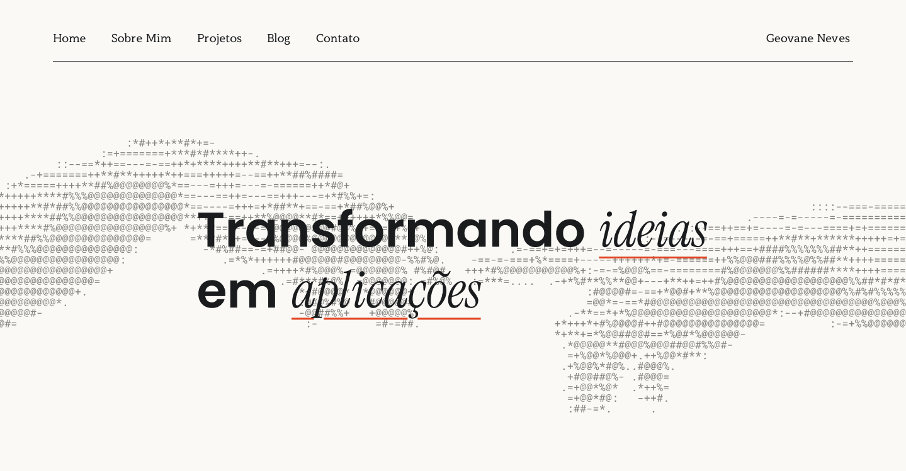
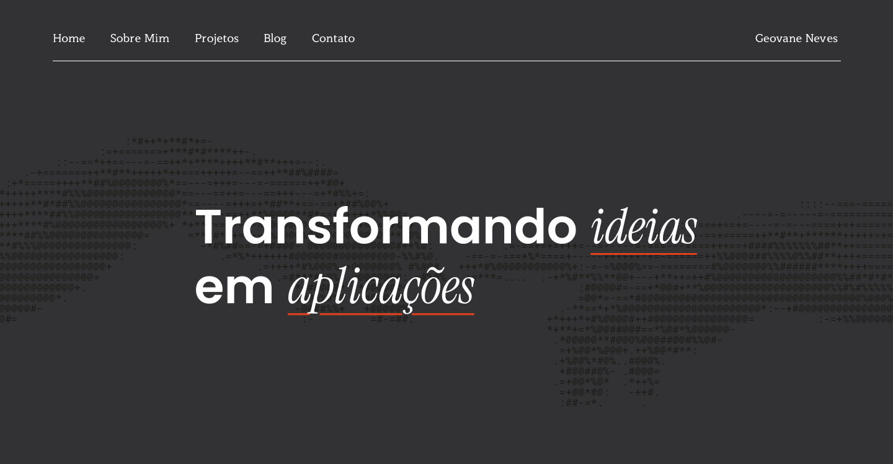

<div align="center">

# Geovane Neves · Portfólio

### Desenvolvimento de software com identidade visual, código limpo e atenção aos detalhes.

**Um portfólio autoral em HTML, CSS e JavaScript puros: sem frameworks, sem build e sem dependências.**

[](index.html)
[](css/style.css)
[](js/theme.js)
[](#tema-claro-e-escuro)
[](#responsividade)
[](#como-executar)

[Visão geral](#visão-geral) · [Funcionalidades](#funcionalidades) · [Tema claro e escuro](#tema-claro-e-escuro) · [Tecnologias](#tecnologias) · [Estrutura](#estrutura-do-projeto) · [Como executar](#como-executar) · [Personalização](#personalização) · [Contato](#contato)

</div>

---

<div align="center">
<div display="flex">


</div>
<sub>Capa do portfólio: tema claro à esquerda, tema escuro à direita. O tema é escolhido automaticamente pelo navegador de quem acessa.</sub>

</div>

---

## Visão geral

Este repositório reúne o código do meu portfólio pessoal, onde apresento minha trajetória, habilidades, experiências, projetos e textos do blog. A proposta foi fugir do portfólio convencional, aquele que apenas reúne projetos e links, e construir uma experiência com personalidade própria: tipografia serifada, uma mão em ASCII animada na capa, cartões com formas recortadas e um formulário em formato de janela.

O projeto é **estático e autocontido**. Ele roda abrindo um único arquivo no navegador e pode ser publicado em qualquer hospedagem de sites estáticos.

## Funcionalidades

| Recurso | Descrição |
| --- | --- |
| **Tema claro e escuro automático** | Um script detecta a preferência do navegador/sistema (`prefers-color-scheme`) e aplica o tema antes da primeira renderização, sem "flash". Se o visitante trocar o tema do sistema com a página aberta, o site acompanha na hora. |
| **Design system com variáveis CSS** | Todas as cores dos dois temas vivem em variáveis na `:root`. Trocar uma cor é editar uma linha. |
| **Capa animada** | Uma mão desenhada em ASCII troca ~4% dos caracteres a cada 150 ms, criando um efeito de "sinal" sem usar canvas ou bibliotecas. |
| **Modais sem JavaScript** | Os detalhes de cada projeto e os 8 posts do blog abrem em modais controlados apenas por CSS (`:target`), com animação de entrada. |
| **Formulário com validação em CSS** | Os erros aparecem somente depois que o usuário interage com o campo (`:user-invalid`). O envio abre o programa de e-mail do visitante via `mailto`. |
| **Layout responsivo** | Cinco faixas de largura, de 1440 px até celulares, com navegação, grades e modais adaptados. |
| **Tipografia local** | A família Poppins é servida a partir de `assets/fonts`, com fontes de apoio do Google Fonts. |
| **Zero dependências** | Sem npm, sem bundler e sem framework. O que está no repositório é o que roda. |

## Tema claro e escuro

O tema **claro é o padrão**. O tema escuro sobrescreve as variáveis quando o `<html>` recebe `data-tema="escuro"`.

```js
// js/theme.js
const preferenciaEscura = window.matchMedia('(prefers-color-scheme: dark)');

function aplicarTema() {
  document.documentElement.dataset.tema = preferenciaEscura.matches ? 'escuro' : 'claro';
}

aplicarTema();
preferenciaEscura.addEventListener('change', aplicarTema);
```

O script é carregado no `<head>`, **sem `defer`**, para que o tema esteja definido antes de a página ser pintada.

**Paleta**

| Variável | Tema claro | Tema escuro | Uso |
| --- | --- | --- | --- |
| `--fundo` | `#faf9f5` | `#333336` | Fundo da página e do formulário |
| `--texto` | `#191b1d` | `#ffffff` | Texto principal |
| `--campo` | `#c7c4bd` | `#1f1f1f` | Campos do formulário |
| `--janela` | `#ffffff` | `#1f1f1f` | Janela do formulário de contato |
| `--mao` | `#828180` | `#464647` | Mão ASCII da capa |
| `--laranja` | `#e2411f` | `#e2411f` | Cor de destaque (igual nos dois temas) |

Elementos que precisam mudar com o tema, mas não são CSS puro, também foram tratados:

- **Ícones** (SVGs brancos): no tema claro recebem `filter: invert(.9)`.
- **Cartões** (fundos em SVG): existem duas versões, `CartaoP.svg`/`CartaoB.svg` e `CartaoP_claro.svg`/`CartaoB_claro.svg`, selecionadas por variáveis CSS.

## Responsividade

| Faixa | Largura | Principais adaptações |
| --- | --- | --- |
| Desktop | ≥ 1440 px | Layout de referência, medidas fixas |
| Notebook | ≤ 1439 px | Grades fluidas, espaçamentos proporcionais |
| Tablet deitado | ≤ 1100 px | Blog em 3 colunas |
| Tablet em pé | ≤ 900 px | Projetos e blog em 2 colunas, seção "Sobre" empilhada |
| Celular | ≤ 640 px | Uma coluna, menu reduzido, mão ASCII ampliada e centralizada |

Em telas menores, os modais viram painéis roláveis com altura máxima de 90% da tela.

## Seções do site

1. **Início:** capa com a mão ASCII animada e o título.
2. **Sobre mim:** trajetória, formação em Análise e Desenvolvimento de Sistemas e foto.
3. **Habilidades:** Java, JavaScript, TypeScript, Python, C, HTML, CSS, Spring Boot, Django, Git, GitHub, Docker, Figma e PostgreSQL.
4. **Experiências:** Projeto Educa Drones, projetos acadêmicos de ADS, RevendeAi e Projeto B-Bordados.
5. **Projetos:** cartões que abrem modais com descrição, imagem e link do repositório.
6. **Blog:** 8 postagens sobre desenvolvimento, APIs REST, planejamento, faculdade e extensão.
7. **Contato:** redes sociais e formulário em formato de janela.

### Projetos em destaque

| Projeto | Stack | Resumo |
| --- | --- | --- |
| **Cart & Order Management API** | Java, REST, DDD, UML | API backend que simula as operações de um e-commerce: usuários, produtos, carrinhos e pedidos, com cálculo de total, controle de estoque e status do pedido. |
| **Raffle-System** | Java, Spring Boot, Maven | Backend de gerenciamento de rifas com autenticação, compra de bilhetes, carteira e sorteio automatizado. *Em desenvolvimento.* |
| **Library Flow API** | Java 17+, Spring Boot, PostgreSQL, JWT | API REST de livraria digital com aluguel, multa por atraso, reservas, arquitetura em camadas e autorização por papéis. |

## Tecnologias

- **HTML5** semântico, com `header`, `nav`, `main`, `section`, `article` e `footer`.
- **CSS3**: variáveis customizadas, Grid, Flexbox, container queries (`cqw`), `:target`, `:user-invalid`, `:has()`, `aspect-ratio` e `color-scheme`.
- **JavaScript** (vanilla): detecção de tema e animação da capa.
- **Fontes:** Poppins (local), Quattrocento, Playfair Display e JetBrains Mono (Google Fonts).

## Estrutura do projeto

```text
geovane-portfolio/
├── index.html                 # Página única: seções, modais e formulário
├── favicon.ico
├── css/
│   ├── style.css              # Fontes, variáveis dos temas, base e layout das seções
│   ├── components.css         # Menu, capa, cards, botão, formulário, rodapé e modais
│   └── responsive.css         # Media queries (notebook, tablet e celular)
├── js/
│   ├── theme.js               # Detecta o tema do navegador e aplica no <html>
│   └── animations.js          # Animação dos caracteres da mão ASCII
└── assets/
    ├── fonts/                 # Poppins (Light, Regular, Medium, Bold e itálicos)
    ├── screenshots/           # Imagens usadas neste README
    └── images/
        ├── icons/             # Ícones de tecnologias e redes sociais (SVG)
        └── projects/          # Cartões (SVG) e imagens dos projetos
```

## Como executar

Não há nada para instalar.

**Opção 1: abrir direto**

```bash
git clone https://github.com/geovane-nves/geovane-portfolio.git
cd geovane-portfolio
```

Abra o arquivo `index.html` no navegador.

**Opção 2: servidor local** (recomendado para simular a hospedagem)

```bash
# Python
python3 -m http.server 8000

# ou Node.js
npx serve .
```

Acesse `http://localhost:8000`.

> [!TIP]
> Para testar os dois temas, use as ferramentas do navegador: no Chrome/Edge, abra o DevTools, depois **Rendering → Emulate CSS media feature `prefers-color-scheme`**. Ou troque o tema do seu sistema operacional.

### Publicação

Por ser um site estático, funciona em qualquer hospedagem: **GitHub Pages**, **Netlify**, **Vercel** ou **Cloudflare Pages**. Basta apontar para a pasta raiz, sem comando de build.

## Personalização

<details>
<summary><strong>Trocar as cores de um tema</strong></summary>

Edite as variáveis em `css/style.css`. O bloco `:root` define o tema claro e o `:root[data-tema="escuro"]` define o escuro.

```css
:root[data-tema="escuro"] {
  --fundo: #333336;
  --texto: #ffffff;
}
```

</details>

<details>
<summary><strong>Adicionar um projeto</strong></summary>

1. Em `index.html`, copie um `<a class="card-p" href="#modal-...">` dentro de `.projetos__lista` e ajuste o `href` e o título.
2. Copie um bloco `<div class="modal" id="modal-...">` e use o mesmo `id` do `href`.
3. Coloque a imagem do projeto em `assets/images/projects/`.

</details>

<details>
<summary><strong>Adicionar uma postagem no blog</strong></summary>

1. Copie um `<a class="card-b" href="#post-N">` dentro de `.blog__lista`. Use `card-b--laranja` para o cartão laranja.
2. Copie um bloco `<div class="modal" id="post-N">` com o texto da postagem.

</details>

<details>
<summary><strong>Trocar o envio do formulário</strong></summary>

Por padrão o formulário usa `mailto:`. Para usar um serviço externo, como o Formspree, troque apenas o `action` e remova o `enctype`:

```html
<form class="form" action="https://formspree.io/f/SEU_ID" method="POST">
```

</details>

<details>
<summary><strong>Desligar a animação da capa</strong></summary>

Remova a linha `<script src="js/animations.js"></script>` do final do `index.html`. A mão ASCII continua visível, só deixa de se mover.

</details>

## Boas práticas adotadas

- Separação clara de responsabilidades entre estrutura (HTML), apresentação (CSS) e comportamento (JS).
- Estilos divididos em três arquivos por função: base, componentes e responsividade.
- Cores centralizadas em variáveis, sem valores repetidos pelo código.
- Interatividade resolvida em CSS sempre que possível (modais, validação, hover), reduzindo JavaScript.
- Elementos decorativos marcados com `aria-hidden` para não poluir leitores de tela.
- Código comentado em português, pensado para ser fácil de manter e evoluir.

## Contato

Disponível para projetos full stack, consultoria técnica ou um bate-papo virtual. Resposta em até 24 h.

[](https://github.com/geovane-nves)
[](https://linkedin.com/in/geovane-nves)
[](https://instagram.com/geovane.nves)
[](mailto:geonevesrodrigues@gmail.com)

## Licença

© 2026 Geovane Neves. Todos os direitos reservados.

O código, os textos e as imagens deste repositório estão disponíveis para consulta. Para reutilizar qualquer parte, entre em contato.
